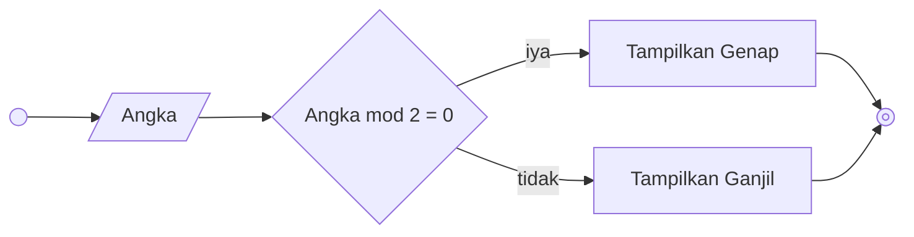

# Minitask Algoritma 1

## Membuat algoritma memindahkan air di dalam gelas

### Deskriptif
1. Mulai
2. Ambil gelas kosong dari lemari piring
3. Letakkan gelas kosong di samping gelas teh dan kopi
4. Tuang isi dari gelas kopi kedalam gelas kosong
5. Tuang isi dari gelas teh kedalam gelas yang sebelumnya berisi kopi
6. Tuang isi dari gelas yang sekarang berisi kopi kedalam gelas yang sebelumnya berisi teh
7. Selesai

## Membuat algoritma menentukan bilangan ganjil atau genap

### Deskriptif
1. Mulai
2. Input angka yang ingin di cek
3. Jika angka tersebut dibagi 2 sisa baginya sama dengan 0 maka angka tersebut termasuk bilangan genap
4. Tampilkan Genap
5. Jika angka tersebut dibagi 2 sisa baginya tidak sama dengan 0 maka angka tersebut termasuk bilangan ganjil
6. Tampilkan Ganjil 
7. Selesai

### Flowchart

## Membuat algoritma menghitung luas dan keliling lingkaran

### Deskriptif
1. Mulai
2. Input/masukkan jari-jari lingkaran yang ingin dihitung
3. Jika jari-jari lingkaran merupakan kelipatan 7 maka phi (π) sama dengan 22/7 
4. Hitung luas lingkaran dengan rumus 22/7 dikali jari-jari dikali jari-jari
5. Hitung keliling lingkaran dengan rumus 2 dikali 22/7 dikali jari-jari
6. Tampilkan hasil luas dan keliling lingkaran
7. Jika jari-jari lingkaran bukan merupakan kelipatan 7 maka phi (π) sama dengan 3.14
8. Hitung luas lingkaran dengan rumus 3.14 dikali jari-jari dikali jari-jari
9. Hitung keliling lingkaran dengan rumus 2 dikali 3.14 dikali jari-jari
10. Tampilkan hasil luas dan keliling lingkaran
11. Selesai

